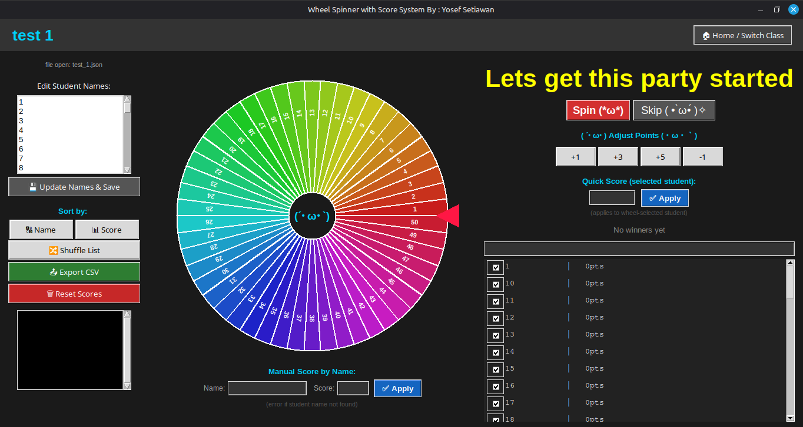
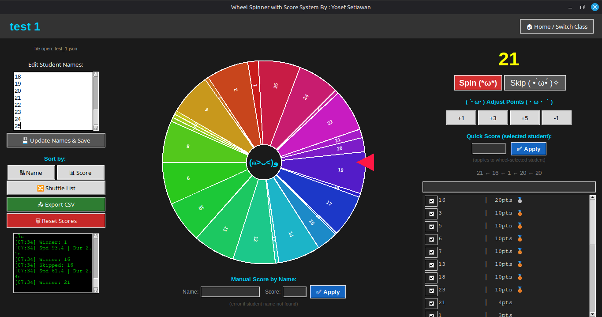

# \\(^ω^\ ) Wheel Spinner with Score System ( /^ω^)/

A desktop app for teachers. Spin a wheel to pick a student, award points, and let the wheel give students with fewer points a bigger slice next time. Built with Python and Tkinter, with no extra installs.

**[Open the project page](https://cloudbv.github.io/wheel-spinner-with-score-system/)** · **[Download on itch.io](https://cloudbv.itch.io/wheel-name-spin-with-score-system)**



## What it does

Wheel Spinner picks a student at random and keeps score for each class you teach. Each class is saved as its own file, so you can switch between classes in one click and your scores are still there next time. It has a full-screen mode for projectors and a large result name that is easy to read from the back of the room.

## A fairer wheel

Slice size depends on score. A student with fewer points gets a bigger slice and is more likely to be picked. A student with many points gets a thin slice.

```
slice weight = 1 / (score + 1)
```

| Score | Weight |
|------:|-------:|
| 0     | 1.00   |
| 3     | 0.25   |
| 9     | 0.10   |
| 19    | 0.05   |
| 99    | 0.01   |

Students marked absent are removed from the wheel, and their scores are kept.



## Features

- **Separate classes:** create, rename, and delete class profiles from the home screen. Each one is a single `.json` file.
- **Spin and skip:** each spin has a random speed and length. The face in the middle of the wheel changes as it slows down, and the winning slice flashes white. Skip a result if you do not want it.
- **Quick points:** +1, +3, +5, and −1 buttons for the student the wheel picked.
- **Custom amounts:** type any whole number in Quick Score for the picked student.
- **Manual score by name:** change anyone's score without spinning. Names are not case-sensitive, and a name that does not exist is rejected, so typos never create new students.
- **Attendance:** untick a student in the scoreboard to take them off the wheel.
- **Scoreboard:** search by name, sort by name or score, and see milestone badges (🥉 10, 🥈 20, 🥇 30, 💎 50).
- **Winner history and log:** the last five winners are shown above the scoreboard, and a timestamped log records spins, winners, skips, and score changes.
- **Edit names in bulk:** one name per line, then Update Names & Save. Existing scores are kept, new names start at 0, removed names are deleted.
- **Export, shuffle, reset:** export scores to CSV, shuffle the list order, or reset all scores to 0 after a confirmation.
- **Automatic backups:** every save also writes a timestamped copy to a `backups` folder. The newest 5 per class are kept.
- **Full screen:** press `F11` for a projector or smartboard.

## Run it

You need Python 3 with Tkinter. Tkinter comes with Python on Windows and macOS. The app uses only the Python standard library.

1. Download the script and put it in its own folder.
2. Open a terminal in that folder.
3. Run:

   ```bash
   python3 wheel_spinner.py
   ```

4. Choose **Create New Class Profile**, then type your students' names, one per line.

On Debian or Ubuntu, if you see an error about `tkinter`:

```bash
sudo apt install python3-tk
```

## Where your data lives

The app saves next to the script, no matter how you launch it.

```
wheel_spinner/
├── wheel_spinner.py
├── Class_A.json
├── Class_B.json
└── backups/
    ├── Class_A_20260101_083000.json
    └── ...
```

Each class file holds every student's score and attendance:

```json
{
  "students":   { "Budi": 4, "Sari": 0 },
  "attendance": { "Budi": true, "Sari": true }
}
```

## Customize it

At the top of the script:

- `SCHOOL_NAME` changes the title on the home screen.
- `MAX_BACKUPS` sets how many backups to keep per class.

Other values, such as spin speed and duration, wheel colors, and badge thresholds, are marked with comments in the code.

## Good to know

- Scores cannot go below 0.
- Only whole numbers are accepted for custom points.
- Wheel names are cut to 10 characters, and scoreboard names to 12.

## Author

Made by Yosef Setiawan.
